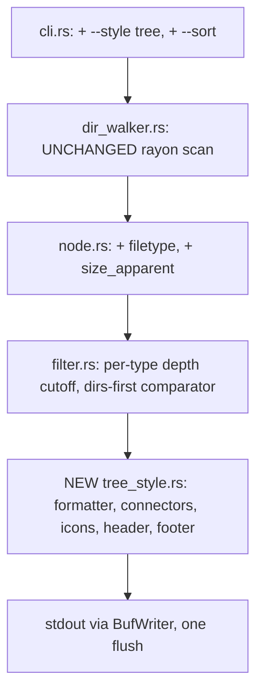

# Implementation Plan: `tree.zsh` → Rust (dust fork)

> **Implementation status (2026-10-24): shipped as option B.** The binary is
> named `tree` (not `dust`), the tree style is the default, and the zsh
> wrapper was removed. Folders are listed by default; `--f` restores the
> legacy script's full listing (directories ≤ N, files/links ≤ N+1), `-f` is
> dust's filecount, `-L` dereferences symlinks, and `--style dust` keeps the
> upstream percent-bar output. The 72 goldens run the binary with `--f`.
> Sections below that describe an additive `--style tree` behind an unchanged
> dust default (§2 goals, §5–§7) are historical; see [README.md](README.md)
> for the shipped behavior. Two plan details were corrected by the goldens:
> symlink rows carry the link's own lstat size (the script's `zstat -L -A`
> does not actually follow links), and files whose relative path starts with
> `-` are dropped and excluded from the footer sum.

**Project:** Replace the hot path of `~/.config/zsh/functions/tree.zsh` with a single Rust binary built from the fork https://github.com/willktech/tree (clean fork of `bootandy/dust` master @ `ae5c770`, branched 2026-10-23). The binary keeps dust's parallel scan engine and adds a new `--style tree` output mode that reproduces the zsh script's output **byte-for-byte**.

**Toolchain on target machine:** rustc/cargo 1.99.1 (rustup), zsh 5.9 (arm64-apple-darwin26.0), gdu-go v5.38.0 (Homebrew), Apple M5 Max (18 cores).

---

## 1. Context and measured baseline

`tree.zsh` (1,017 lines) orchestrates gdu (parallel Go scanner) + zsh globbing + zsh built-ins. Measured on a 10,000-file / 600-directory corpus on the M5 Max:

| Measurement | Time |
|---|---|
| `gdu -cnp --depth 3 --no-prefix .` (scan alone) | ~30 ms |
| Full script `tree 3` (zsh/stat loaded) | **~1.65 s** |
| Full script `tree 2` | ~1.58 s |
| Full script `tree 1` | ~1.01 s |
| Full script `tree 0` (top level only) | ~0.04 s |

Phase breakdown of the 1.65 s (instrumented with `EPOCHREALTIME`):

| Phase | Time | Root cause |
|---|---|---|
| gdu read loop (L326–435) | 0.52 s | ~10.6k lines × 6 expansions + one `[[ -d ]]` stat per line |
| glob + per-file `zstat` (L442–578) | 0.46 s | 10k files re-globbed and re-stat'd — data gdu already emitted |
| sort-key build (L636–688) | 0.24 s | `printf -v '%019d'` per path component (~21k calls) |
| render loop (L805–936) | 0.27 s | 10.6k `printf` builtins + per-row path split + per-ancestor hash lookups |
| sibling pass (L724–755) | 0.09 s | two hash lookups per row |
| native sort + index extract | 0.10 s | acceptable |

**98% of runtime is zsh interpretation overhead.** Additional findings:

- **Double work:** gdu's output already contains every file row with its size (indentation encodes depth). The script discards those rows (`[[ -d ]] || continue`), then re-globs and re-stats all files to recover the same data.
- **Autoload landmine:** the script never runs `zmodload zsh/stat`. In a shell where the module isn't preloaded, every `zstat` fails silently → runtime 1.65 s → 9 s and file sizes vanish. (Fixed implicitly by this project; the zsh wrapper no longer stats anything.)
- **Batched `zstat`** (one call, all files) measures 12 ms vs 93 ms per-file for 10k files — kept as a fallback optimization for the zsh wrapper's footer.

## 2. Goals / non-goals

**Goals**
1. Single Rust binary (dust fork) doing scan → aggregate → sort → render in one process.
2. Output byte-identical to the current script on all benchmark corpora, both sort modes, depths 0–3 (golden tests, §8).
3. Performance targets on M5 Max: 10k files ≤ 60 ms; 100k files ≤ 200 ms (scan-bound).
4. All changes additive and gated behind `--style tree` so the fork rebases cleanly on upstream.

**Non-goals**
- No TUI, no interactive mode changes, no changes to default dust output.
- No new required dependencies beyond what dust already ships (rayon, clap, thousands, unicode-width, stfu8, lscolors, nu-ansi-term are already in the tree).
- No caching layer (possible follow-up; see §10).

## 3. Target architecture



What dust already provides for free (do not rebuild):

| Capability | dust location |
|---|---|
| Parallel rayon walk, flat tasks, O(1) stack, EINTR retry | `src/dir_walker.rs` (`walk_it`, `walk_dir`, `finalize_chain`) |
| Recursive dir size aggregation | `clean_inodes` in `src/dir_walker.rs` |
| Hardlink dedup by (inode, device) | `FxHashSet` in `clean_inodes` |
| Blocks-usage vs apparent size via `get_metadata` | `src/platform.rs` |
| Tree connectors `├── └── │` (has-later-sibling logic) | `get_tree_chars` / `clean_indentation_string` in `src/display.rs` |
| Comma thousands (`thousands::Separable`) | used in `src/display.rs` |
| Size-then-name `Ord` on `Node` | `src/node.rs` |
| Depth limit | `add_children` in `src/filter.rs` |
| NO_COLOR / TTY detection, ctrl-c, config file | `src/main.rs`, `src/config.rs` |

## 4. Display contract (normative spec)

This is the behavior of `tree.zsh` that must be reproduced exactly. Line references are to `~/.config/zsh/functions/tree.zsh`.

### 4.1 Invocation (current)

`tree [depth] [directory] [--sort size|name]` — default depth 0, default sort `size`. The zsh wrapper keeps this surface (§7).

### 4.2 Data sources and depth semantics

- **Depth 0:** top-level directories (recursive sizes), top-level files, top-level symlinks. Nothing deeper.
- **Depth N > 0:** directories up to depth N; files and symlinks up to depth **N+1** (the script's deliberate quirk — glob loop runs `lvl = 1..display_depth+1`).
- Dotfiles included at all levels (script globs use `D`; gdu includes hidden by default).
- Directory sizes = **disk usage** (blocks; gdu default). File sizes = **apparent size** (`zstat -L`, follows symlinks). This mixed semantics is preserved exactly by storing both sizes per node in Rust.
- Symlinks: shown as rows (icon `󰌷`), size = target's apparent size; **not descended into**; dangling → size 0.
- Hardlink dedup: gdu dedups by inode; dust's `clean_inodes` also dedups. **Decision D1 (§5)** governs the divergence risk.

### 4.3 Size formatting

- Fixed column, right-aligned, minimum width 8, grows to longest formatted value in the run (`maxw`, L287, L423–425, L776–778).
- **Directories and files:** value in MiB (1 MiB = 1,048,576 B), **blank if < 1 MiB**, **round half-to-even** (L115–131: `q = b/1048576`, `r = b%1048576`, round up if `r > 524288` or (`r == 524288` and `q` odd)). No thousands separators.
- **Symlinks at depth ≥ 1:** comma-grouped integer MiB (truncating division), blank if < 1 MiB (L561–565). *Known quirk: differs from files/dirs (commas + truncation). Preserve as-is.*
- **Symlinks at depth 0:** MiB formatter (same as files/dirs, L490). *Another quirk — depth-dependent. Preserve.*
- **Header total:** comma-grouped truncating MiB + suffix `Mb` (L773–774).
- **Footer file total:** adaptive human units `b/Kb/Mb/Gb` with `%.1f`/`%.3f` float formatting (L162–180; Rust's `{:.1}`/`{:.3}` are round-half-to-even, matching C printf used by zsh).

### 4.4 Sorting

- **`size` mode (default):** per-path-component composite key, ascending lexical (byte order): `rank(1 digit: 0=dir, 1=other) + inverted size zero-padded to 19 digits (max64 − size) + component name`, components joined by `\x01`. Ancestors not in the visible directory set use rank 1 / inverted size = max64. Net effect at every level: **dirs first, then size descending, name ascending on ties** (L636–688).
- **`name` mode:** components joined by `\x01`, ascending; directories get a trailing `\x01` so on identical basenames **files sort before dirs** (L674–682).
- Byte-order comparison. Rust's `PathBuf::cmp` is component-wise byte order on unix — matches directly.

### 4.5 Row layout

All rows: two leading spaces, size column (`maxw`), two spaces, then:

| Row type | Layout |
|---|---|
| Top-level dir (depth 1) | `COLOR_DIR + DIR_ICON + ' ' + name + '/' + RESET` |
| Top-level file | `FILE_ICON + ' ' + name` |
| Top-level symlink | `LINK_ICON + ' ' + name` |
| Nested dir (depth > 1) | `prefix + connector + COLOR_DIR + DIR_ICON + ' ' + name + '/' + RESET` |
| Nested file/link (depth > 1) | `prefix + connector + ICON + ' ' + name` |

- `prefix`: for each ancestor level: `COLOR_BRANCH + '│   ' + RESET` if that ancestor has a later sibling, else four spaces.
- `connector`: `COLOR_BRANCH + '├── ' + RESET` if this row has a later sibling, else `COLOR_BRANCH + '└── ' + RESET`.
- "Has later sibling" = not the last child of its parent **in display order** (L724–755). In sorted order siblings are contiguous, so this is computable in one forward pass: `has_later_sibling(row) = next row's parent == row's parent`.

### 4.6 Header and footer

```
(blank line)
  <total_hdr right-aligned to maxw>  <dir_hdr>
  <dashes to maxw>  <dashes to max(4, len(dir_hdr))>
(blank line)
<rows...>
(blank line)
<nfiles> file(s) (<human size>)
```

- `dir_hdr`: `N dirs` / `1 dir` — count of **top-level directories only** (fresh glob `*(DN/)`, L762–771).
- `nfiles` / size in footer: **top-level files only** (count from `*(DN.)` glob, sum of their apparent sizes, L250–271, L945–957).
- Empty-result path (L585–604): header, then `No entries found.`, then footer.

### 4.7 Colors

- `TREE_COLOR_DIR` = `\033[1;34m` (bold blue), `TREE_COLOR_BRANCH` = `\033[2m` (dim), `TREE_COLOR_RESET` = `\033[0m`. Icons are uncolored.
- The script colors unconditionally. The binary gates on TTY/NO_COLOR (dust's existing `should_init_color`) — accepted deviation, documented; golden tests run with colors forced on (`--force-colors`).

## 5. Semantic decisions (locked before coding)

| # | Decision | Rationale |
|---|---|---|
| **D1** | Keep dust's inode dedup (usage mode). Golden test on a hardlink corpus will verify agreement with gdu; if they diverge on *which* row wins a dedup, pin determinism by inode order (dust already sorts children by inode in `clean_inodes` — likely already deterministic). | gdu also dedups; divergence limited to winner selection order. |
| **D2** | Preserve mixed size semantics exactly: dirs = usage, files = apparent, symlinks = target apparent (fallback 0). | Free in Rust (store both per node); awk couldn't do this — it's a headline reason for the Rust route. |
| **D3** | Port the script's integer round-half-even formatter; do **not** reuse dust's `human_readable_number`. | Byte-identical goldens. |
| **D4** | Script `tree` (depth 0) maps to scan depth 1, display top level only. | Matches current gdu call (L315–319). |
| **D5** | Preserve the depth-dependent symlink formatter quirk (§4.3) and the files-before-dirs tie in name mode (§4.4). | Byte-identical goldens; revisit post-launch if the user wants cleanup. |
| **D6** | Permission-denied dirs: keep dust's stderr note (script silently skips). Stdout stays byte-identical; stderr is out of golden scope. | Strictly better UX; no stdout impact. |

## 6. Module-by-module implementation

### 6.1 `src/node.rs` — extend `Node`

```rust
pub struct Node {
    pub name: PathBuf,
    pub size: u64,            // existing: usage (blocks) or apparent per global mode
    pub size_apparent: u64,   // NEW: always apparent size (stat, follows symlinks per policy)
    pub filetype: FileType,   // NEW: Dir | File | Symlink  (from DirEntry::file_type, lstat)
    pub children: Vec<Node>,
    pub inode_device: Option<(u64, u64)>,
    pub depth: usize,
}
```

- Populate in `build_node` / `process_entry` (`dir_walker.rs`) — the walker already knows `is_symlink`/`is_file`; thread `filetype` through. `platform.rs::get_metadata` already returns size + inode; extend to return both block-size and apparent-size unconditionally (one `statfs`-free `stat`/`lstat` pair per entry — negligible at scan time).
- Symlink display size: for `filetype == Symlink`, `size_apparent` = target's size via `stat()` (follow); on error (dangling) → 0. Do **not** descend (leave `follow_links` off; dust's `process_entry` already treats symlinks as leaves when `follow_links == false`).
- Keep existing `Ord` untouched (dust default output must not change).

### 6.2 `src/cli.rs` — new flags (additive)

```rust
#[arg(long, value_enum, default_value = "dust")]
pub style: OutputStyle,          // Dust | Tree

#[arg(long, value_enum, default_value = "size")]
pub sort: SortMode,              // Size | Name  (tree style only; dust keeps current behavior)
```

- `--style tree` implies: no percent bars, no name truncation, no terminal-width math, `number_of_lines = usize::MAX`, colors via existing `should_init_color`/`--force-colors`.

### 6.3 `src/filter.rs` — tree-mode aggregation

- **Per-type depth cutoff** in `add_children`/`always_add_children`: when `style == Tree`, keep a node if `(is_dir && depth <= N) || (!is_dir && depth <= N+1)`. Existing behavior untouched for `style == Dust`.
- **Pure tree pass:** with `number_of_lines == usize::MAX` the heap loop in `fill_remaining_lines` already drains everything — no change needed, just confirm no truncation path fires.
- **Comparator for tree mode** (new fn, used in `build_display_node` when style is Tree):
  - `size` mode: per-level `rank (dirs first) → size desc → name asc (byte order)`.
  - `name` mode: per-level `name asc (byte order)`, files before dirs on identical basenames.
  - Implement as a recursive per-group sort during rebuild (children sorted within each parent) — this is exactly what the script's composite-key global sort produces; per-group sorting is equivalent and simpler.

### 6.4 `src/tree_style.rs` — NEW module (the renderer, ~300 lines)

- `fn fmt_mib_half_even(bytes: u64) -> String` — port of `_tree_fmt_mib` (§4.3): blank if < 1 MiB, integer div/mod, round half-to-even, right-align to maxw.
- `fn fmt_comma_mib(bytes: u64) -> String` — port of `_tree_fmt_comma` (truncating division, `thousands::Separable`).
- `fn fmt_human(bytes: u64) -> String` — port of `_tree_fmt_human` (b/Kb/Mb/Gb, `{:.1}`/`{:.3}`).
- Constants: icons `󰉋 󰈔 󰌷`, ANSI codes (§4.7).
- `fn render_tree(root: &DisplayNode, opts: &TreeOpts) -> String`:
  - Compute `maxw` = max(8, longest formatted size incl. header total).
  - Header block (§4.6) — needs top-level dir count, top-level file count, top-level file size sum: all available from the tree (root's direct children by `filetype`).
  - DFS in sorted order; siblings contiguous → `has_later_sibling = next sibling exists`; maintain prefix stack incrementally (push/pop on depth change) — no per-row path splitting.
  - Row layouts per §4.5.
  - Empty path per §4.6.
- Single `BufWriter<Stdout>` flush at the end.

### 6.5 `src/main.rs` — wiring

- When `style == Tree`: skip progress indicator spawn (or keep — it writes to stderr; decision: keep, matches dust), route to `tree_style::render_tree` instead of `draw_it`. JSON output path unchanged.

## 7. CLI + zsh wrapper

Binary (in fork):

```
ztree --style tree [--sort size|name] [--depth N] [PATH] [--force-colors]
```

`tree.zsh` shrinks to an arg shim preserving muscle memory (positional depth, optional dir, `--sort`):

```zsh
tree() {
    # ... existing arg parsing (L966–1007) unchanged ...
    exec ztree --style tree --sort "$sort_mode" --depth "$display_depth" "$target_dir"
}
```

- Keep the old implementation as `tree_legacy()` for one release (A/B + regression checking).
- Install: `cargo install --path . --force` (binary name stays `dust`; add a `ztree` symlink or alias, or rename the fork's bin to `ztree` — operator's choice; plan assumes `ztree`).
- The wrapper no longer needs `zsh/stat`, `gdu-go`, or any globbing. Update the header comment in `tree.zsh` (drop the `Requires: gdu-go` block once the legacy function is retired).

## 8. Test strategy

### 8.1 Golden-file harness (build first — M0)

- Location: `tests/golden/` in the fork; runner `scripts/golden.sh`.
- For each corpus × depth {0,1,2,3} × sort {size,name}: capture current script output (run under `zsh -f` **with `zmodload zsh/stat` preloaded** — see §1 landmine; colors on) → `tests/golden/<corpus>.<depth>.<sort>.expected`.
- Runner: run new binary with `--force-colors`, `diff` against expected. Exit non-zero on any diff.
- Determinism check: capture each golden 3× during M0; any corpus that isn't stable across runs (dedup winner order, §5 D1) gets flagged and resolved before M2.

### 8.2 Corpora (generator script `scripts/make_corpus.sh`, spec in Appendix B)

| Name | Spec |
|---|---|
| tiny | 10 dirs × 10 files, sizes 0–2 MB |
| medium | 200 dirs × 50 files + 2 subdirs each, sizes 0–2 MB (the §1 corpus) |
| large | 2,000 dirs × 50 files (~100k files) |
| deep | 500-level single-child chain + 10 files per level |
| symlinks | 200 symlinks to files, 50 to dirs, 20 dangling |
| unicode | names with spaces, CJK, emoji, dots, leading dashes |
| hardlinks | 100 files, each with 2 links |
| perms | one `chmod 000` subdir, one empty dir |
| empty | dir with no entries (tests "No entries found." path) |

### 8.3 Unit tests (Rust)

- Formatter: round-half-even boundaries (r = 524288 with q even/odd, r > / < threshold), blank < 1 MiB, comma grouping, maxw growth.
- Comparator: dirs-first rank, size-desc ties, name-mode files-before-dirs tie.
- Per-type depth cutoff: dir at N kept, file at N+1 kept, file at N+2 dropped.
- Symlink policy: target size, dangling → 0, no descent.

### 8.4 Benchmarks

- `criterion` benches on medium + large corpora, split scan vs render.
- Targets (§2). Record before/after in the PR description.

### 8.5 CI

- Fork inherits dust's GitHub Actions; add one `macos-14` (arm64) job running `scripts/golden.sh` + `cargo test`. Linux goldens: generate on macOS only (APFS sizes differ on other filesystems — golden tests are macOS-only by design).

## 9. Milestones

| # | Deliverable | Effort | Acceptance |
|---|---|---|---|
| **M0** | Corpus generator + golden harness + frozen baselines; D1 determinism resolved | ½ day | `scripts/golden.sh` passes with the legacy script vs itself (3× stable); all decisions §5 signed off |
| **M1** | `node.rs`/`cli.rs`/`platform.rs` changes + `tree_style.rs` formatters with unit tests | 1 day | `cargo test` green; default dust output byte-unchanged (existing test suite) |
| **M2** | `filter.rs` per-type depth + comparators; full `tree_style.rs` renderer | 1–1.5 days | Goldens byte-identical on tiny + medium, both sorts, depths 0–3 |
| **M3** | Symlink policy, empty path, edge corpora | ½ day | All goldens green incl. unicode/symlink/hardlink/perms/deep/empty |
| **M4** | Criterion benches, zsh wrapper swap (`tree_legacy` kept), README, install | ½ day | Perf targets met on M5 Max; `tree 2` in interactive zsh produces identical output to `tree_legacy 2` |

Total: **~3–4 focused days.**

## 10. Risks and mitigations

| Risk | Mitigation |
|---|---|
| Upstream drift (fork diverges from bootandy/dust) | Everything additive behind `--style tree`; new module; no edits to existing render paths |
| Dedup winner-order nondeterminism (D1) | M0 stability check; dust's inode-sorted `clean_inodes` likely already deterministic; else pin by inode order |
| APFS clone files (distinct inodes, shared storage) make usage sizes differ from gdu | Verify on a clone-heavy real-world dir (e.g. `~/Pictures`) during M0; both tools count full blocks per clone — expected to agree |
| Nerd-font icons in CI runners | Irrelevant — goldens compare bytes, not glyphs |
| Terminal width / truncation differences | Tree style never truncates (script doesn't) |
| Progress indicator writing to stdout | dust's progress goes to stderr; confirm no stdout pollution in goldens (M2) |
| `zsh -f` benchmark trap (zsh/stat) | Harness always preloads `zmodload zsh/stat` when capturing legacy goldens |

## Appendix A — Environment and measured data

- zsh 5.9 (arm64-apple-darwin26.0); gdu-go v5.38.0 (`/opt/homebrew/bin/gdu-go`); rustc/cargo 1.99.1 via rustup; Apple M5 Max, 18 cores.
- Medium corpus: 10,000 files / 200 top dirs / 200 subdirs, random sizes 0–2 MB.
- gdu scan alone: 30 ms. Full script: tree 3 ≈ 1.65 s, tree 2 ≈ 1.58 s, tree 1 ≈ 1.01 s, tree 0 ≈ 0.04 s.
- Batched `zstat` for 10k files: 12 ms (vs 93 ms per-file).
- Without `zsh/stat` preloaded: 9 s (autoload-failure storm) — do not benchmark this way.

## Appendix B — Corpus generator spec

`scripts/make_corpus.sh <dest>`: for each corpus in §8.2, create the layout with random file sizes 0–2 MB (`mkfile`/`dd`/`head -c $((RANDOM)) /dev/urandom`), fixed seed where possible, symlinks via `ln -s`, hardlinks via `ln`, perms via `chmod 000`. Corpora are committed as generators, not as files (goldens are committed).

## Appendix C — Key commands

```bash
# Clone the fork (operator adjusts location as needed)
git clone https://github.com/willktech/tree.git ~/projects/tree
cd ~/projects/dust && cargo build --release          # baseline build check

# Capture a legacy golden (note the zmodload — see §1)
zsh -f -c 'zmodload zsh/stat; cd "$1"; source ~/.config/zsh/functions/tree.zsh; tree 3' \
  -- "$CORPUS/medium" > tests/golden/medium.3.size.expected

# New binary, same shot
./target/release/tree --sort size --depth 3 --f --force-colors "$CORPUS/medium" \
  > /tmp/actual && diff tests/golden/medium.3.size.expected /tmp/actual

# Full suites
cargo test
./scripts/golden.sh
cargo bench --bench scan_render
```
